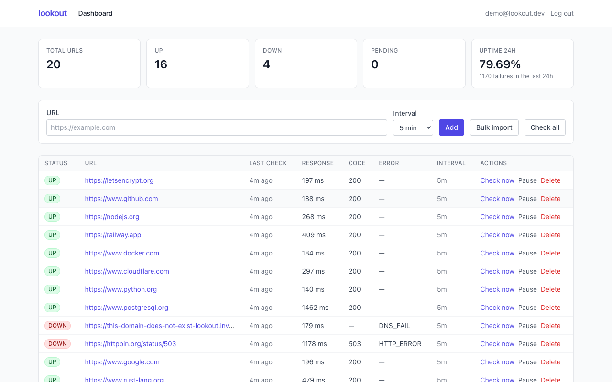
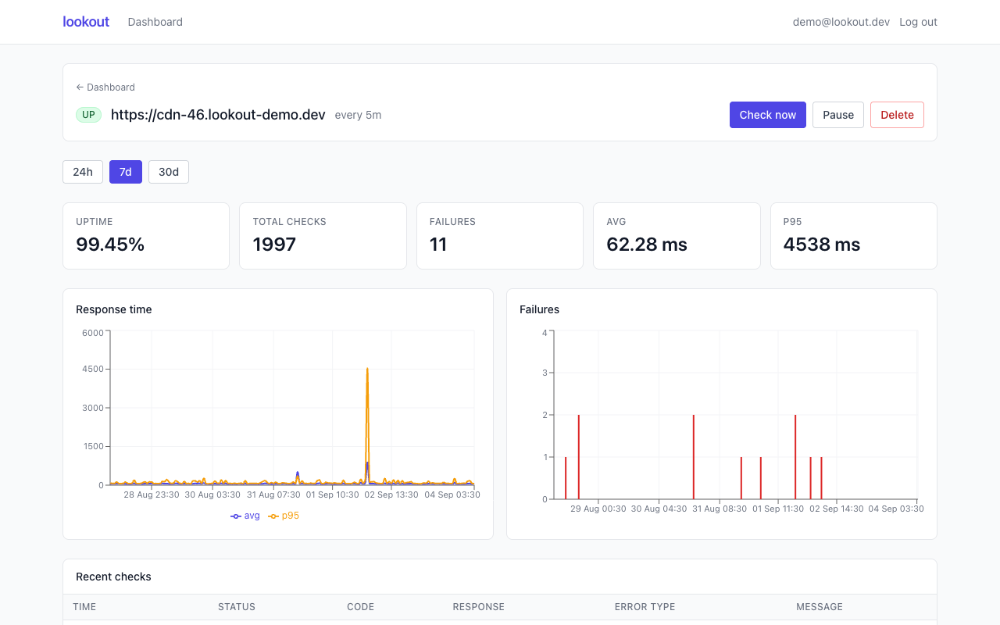
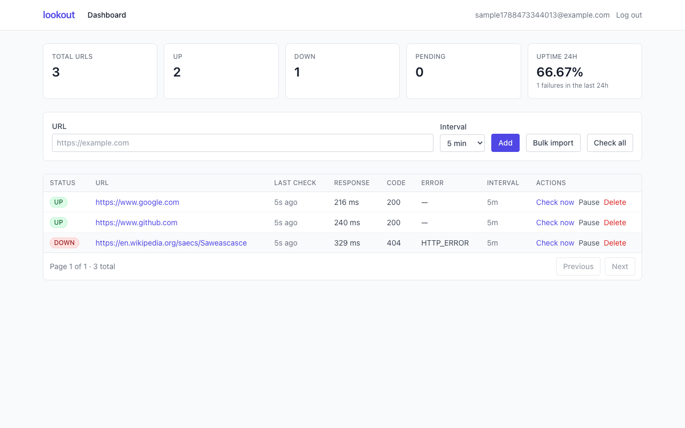
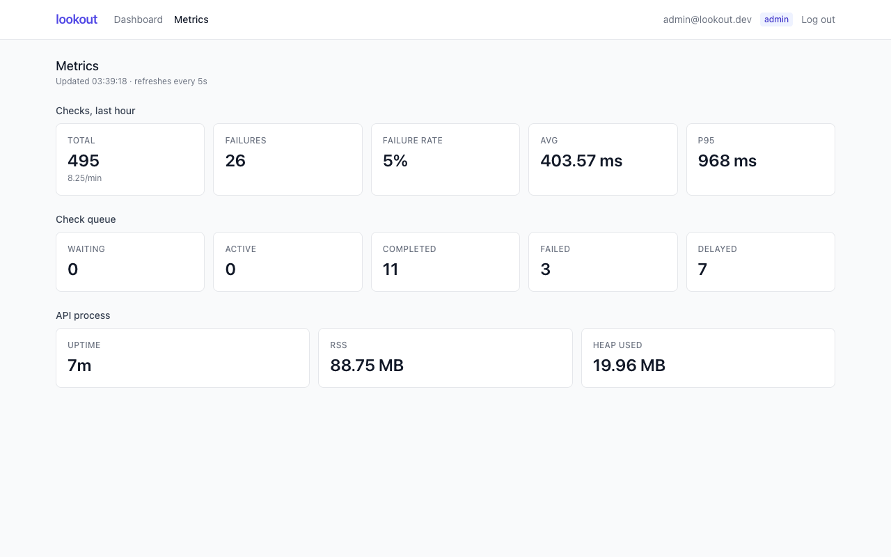
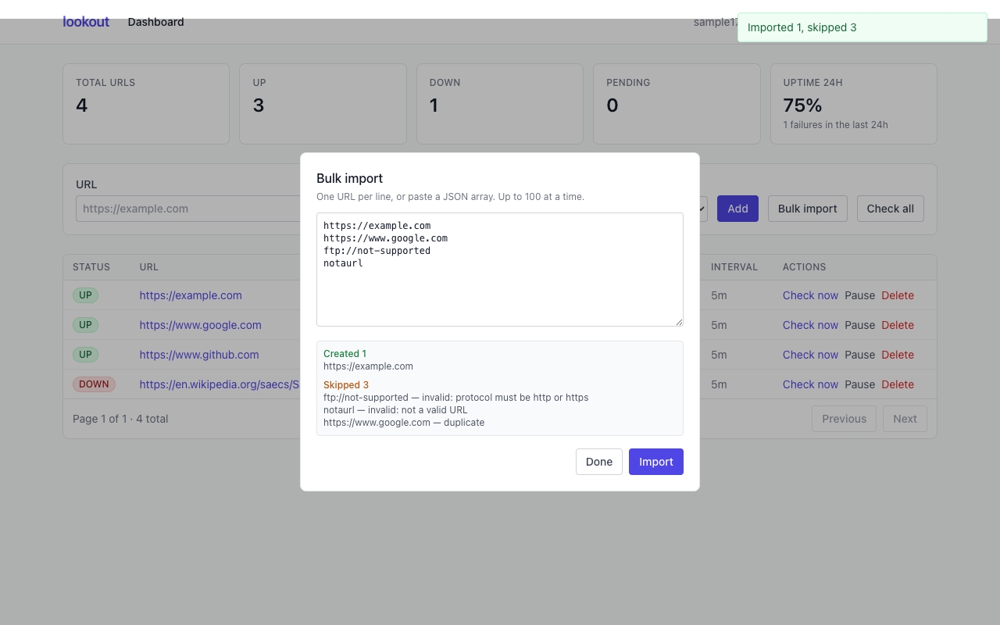

# lookout

Watches URLs on a schedule, records whether they are up and how fast they respond, and shows it on a dashboard. Logs are JSON and every request can be traced across processes.



## Live demo

- App: https://lookout-dusky.vercel.app
- API health: https://lookout-production-783d.up.railway.app/health

Sign in as `demo@lookout.dev` / `demo1234` to see the seeded data: 20 real public URLs with 40k checks over 7 days. Sign in as `admin@lookout.dev` / `admin1234` to also see the metrics page. A new signup starts empty, and **Try the sample** fills it.

The frontend runs on Vercel. The api and worker run on Railway with Postgres and Redis. See [docs/DEPLOY.md](docs/DEPLOY.md).

## Quick start

You need Docker and Docker Compose.

```bash
cp .env.example .env
# JWT_SECRET must be at least 32 characters:
openssl rand -base64 32          # paste the output into JWT_SECRET in .env

docker compose up --build -d
```

Open <http://localhost:8080>, sign up, and click **Try the sample**. After a few seconds the table shows the three sample URLs: two UP, one DOWN with a 404.

Optional. Seed 20 real public URLs with seven days of history, 40,320 checks, in about 3 seconds:

```bash
docker compose exec api node dist/scripts/seed.js
# re-run over existing demo data with: ... seed.js --force
```

This creates `demo@lookout.dev` / `demo1234` (USER) and `admin@lookout.dev` / `admin1234` (ADMIN). To get the admin view on an account you create yourself, set `ADMIN_EMAILS` in `.env` before starting.

The seeded URLs are real, and their fake history is written at the same 5 minute spacing the worker uses. So once checks start running, live results match the history instead of contradicting it. Sixteen hosts are healthy. Four always fail: a 404, a 503, an expired certificate, and a domain that does not exist.

To run without app containers, in three terminals:

```bash
docker compose -f docker-compose.yml -f docker-compose.dev.yml up -d postgres redis
cd backend  && cp .env.example .env && npm install && npm run db:migrate && npm run dev
cd backend  && npm run worker
cd frontend && npm install && npm run dev      # http://localhost:5173, proxies /api to :4000
```

## What it does

| Requirement | What was built | Where |
| --- | --- | --- |
| Authentication | Email/password signup and login, bcryptjs (cost 12), stateless JWT bearer tokens, `requireAuth` re-loads the user from the DB on every request | `backend/src/modules/auth/` |
| Monitoring engine | Native `fetch` checker with a per-check timeout, redirect following, and a seven-value error taxonomy | `backend/src/modules/checks/checker.ts`, `classifyError.ts` |
| Concurrency and scheduling | BullMQ job scheduler per URL at its own interval; worker concurrency cap; inline semaphore for batch checks | `backend/src/queue/`, `backend/src/worker.ts` |
| Database | Postgres 16 via Prisma; four tables; hourly rollups and 7-day retention on raw checks | `backend/prisma/schema.prisma`, `backend/src/modules/stats/` |
| UI | React SPA: dashboard with live summary and table, per-URL detail with charts, admin metrics | `frontend/src/pages/` |
| Logging | pino structured JSON, per-request levels, correlation IDs spanning API and worker | `backend/src/logger.ts`, `backend/src/app.ts` |

Extras built: user and admin roles, a Redis queue with background workers, a live dashboard by polling, JSON logs, per-route log levels, request IDs that carry across processes, an admin metrics endpoint, retries with backoff, Docker deployment behind nginx, GitHub Actions CI, rate limiting on auth, and uptime and percentile numbers.

Not built: WebSockets, email or webhook alerts, and any tenancy model beyond per-user ownership with an admin override.

## Architecture

```
                    ┌──────────────────────────────────────────┐
  browser ────────▶ │ nginx  :8080                             │
                    │  · serves the built SPA                  │
                    │  · proxies /api ──────────────┐          │
                    └───────────────────────────────┼──────────┘
                                                    ▼
                              ┌──────────────────────────────┐
                              │ api (express)  :4000         │
                              │  · REST + auth               │
                              │  · enqueues checks           │
                              └────┬────────────────────┬────┘
                                   │                    │
                          reads/writes            enqueue jobs
                                   │                    │
                                   ▼                    ▼
                         ┌──────────────────┐   ┌──────────────┐
                         │ postgres  :5432  │   │ redis  :6379 │
                         └──────────────────┘   └──────┬───────┘
                                   ▲                   │ consume
                                   │                   ▼
                                   │        ┌────────────────────────┐
                                   └────────┤ worker                 │
                                 writes     │  · checks queue        │
                                 checks     │  · maintenance queue   │
                                            └────────────────────────┘
```

- The api and worker are two processes from the same image, started with different commands. The api never runs a worker, so a slow site cannot slow down HTTP requests, and checks keep running while the api restarts.
- Each URL gets one BullMQ scheduler, keyed `url:<id>`, firing at that URL's interval.
- Postgres decides what should be scheduled. On boot the worker adds a scheduler for every active URL and deletes any scheduler whose URL is gone. A wiped Redis or a crash halfway through a write fixes itself on the next start. The seed script does the same reconcile when it finishes.
- "Check now" uses the same queue at priority 1, so a waiting person goes ahead of the scheduled backlog. The api waits up to 15s, then returns 202 with a job id.
- A second `maintenance` queue rolls up stats every 5 minutes and deletes old checks every 24 hours.
- A DOWN result is a **successful** job. Only real faults throw and retry with backoff, such as Postgres being unreachable or the URL row being deleted. If a down site counted as a failed job, BullMQ would retry it three times per interval, hammering a site that is already struggling and writing three DOWN rows for one outage.
- Response time is measured up to the response headers. `fetch` resolves when headers arrive, the timer stops there, and the body is thrown away unread. That measures how fast the server answers, not how big the page is.

## Data model and query design

Four tables: `users`, `urls`, `checks`, `url_stats_hourly`.

`checks` is the one that grows forever, so its key is a `bigint` counter rather than a UUID. Its index is `(url_id, checked_at DESC)`, which is the shape of both reads: the last N checks for one URL, and the single latest check per URL. A second index on `checked_at` alone is used for deleting old rows and for rollup windows.

`url_stats_hourly` keeps dashboard reads fast as history piles up. The 24h view reads raw `checks` in 15 minute buckets, because hourly rows cannot give that detail. The 7d and 30d views read only `url_stats_hourly` and never touch raw checks. Raw checks are deleted after 7 days (`CHECK_RETENTION_DAYS`) in batches of 10,000. The hourly rows are kept.

### Latest check per URL

The dashboard needs the newest check for every URL. It is the most frequent read in the app. The obvious way is `DISTINCT ON (url_id) ... ORDER BY url_id, checked_at DESC`. That does use `checks_url_id_checked_at_idx`, but only to read it in order. It walks every entry for those URLs and throws away all but the first of each group. Measured at 60 URLs and 120k checks:

| Query | Time | Index rows scanned | Buffers |
| --- | --- | --- | --- |
| `DISTINCT ON (url_id)` | 50.4 ms | 120,009 | 121,237 |
| `LEFT JOIN LATERAL ... LIMIT 1` | 0.51 ms | 60 seeks | 240 |

The lateral version is the one used. Its cost grows with the number of URLs, not the number of checks. `EXPLAIN (ANALYZE, BUFFERS)` on the seeded data plus a few test URLs, 40,391 checks and 27 URLs:

```
Nested Loop Left Join  (actual time=0.031..0.176 rows=20 loops=1)
  Buffers: shared hit=82
  ->  Seq Scan on urls u  (rows=20)
  ->  Limit  (actual time=0.008..0.008 rows=1 loops=20)
        ->  Index Scan using checks_url_id_checked_at_idx on checks c
              Index Cond: (url_id = u.id)
Execution Time: 0.200 ms
```

On that same data: dashboard summary 6-11 ms, per-URL stats 24h 14 ms, 7d 9 ms, 30d 8 ms. The seed writes 40,320 rows in about 1.9s using `createMany` in batches of 5,000, then rolls up 169 hours into 3,394 rows in under 200 ms. The table above comes from a separate 120k row test, which is where the index design was checked.



## Health check engine

A check is **UP** when the final status, after redirects, is 200 to 299. Anything else is **DOWN** and the status code is saved. Thrown errors are sorted by `err.cause.code`, which is where undici puts the real socket error.

| Error type | Verified against |
| --- | --- |
| `HTTP_ERROR` | `https://en.wikipedia.org/saecs/Saweascasce` → 404 |
| `DNS_FAIL` | `https://this-domain-does-not-exist-lookout.invalid` → ENOTFOUND |
| `CONN_REFUSED` | `http://127.0.0.1:9999` → ECONNREFUSED |
| `TLS_ERROR` | `https://expired.badssl.com` → CERT_HAS_EXPIRED |
| `INVALID_URL` | `http://127.0.0.1:1` → see note below |
| `TIMEOUT` | local server that never responds, with `timeoutMs: 500` |
| `UNKNOWN` | anything unrecognised, with the code kept in the message |

Any code containing `CERT` counts as a TLS error, so self-signed and untrusted-root certificates are caught too, not just expired ones.

`http://127.0.0.1:1` reports `INVALID_URL`, not `CONN_REFUSED`. Port 1 is on the fetch spec's blocked ports list, so undici refuses before opening a socket. Nothing was refused by a server, and the error has no code, so calling it a refused connection would be wrong.

The worker runs up to `CHECK_CONCURRENCY` (default 10) checks at once. The api's batch path uses a small semaphore written inline with the same limit, instead of adding a dependency. Seven real checks against live sites finished together in about 800 ms.

Tests: 28 unit tests, none of which touch the network. 23 cover the error classifier using fake error objects with the right `name` and `cause.code`. 5 cover the checker against a local HTTP server on a random port with `/ok`, `/slow`, `/500`, and `/redirect`, plus a port that is opened and closed again to get a real ECONNREFUSED.



## Observability

Logs are pino JSON on stdout. They are only pretty printed in development, via `LOG_PRETTY`. Request logs are `info`, 4xx is `warn`, 5xx and thrown errors are `error`. `/health` logs at `debug` so the healthcheck hitting it every 10 seconds does not bury everything else.

Every request gets an `x-request-id`. An incoming header is kept if there is one, otherwise a new id is made, and it is sent back on the response. The request logger lives in an `AsyncLocalStorage`, so `getLogger()` anywhere in the service layer already carries `reqId` and no function needs a logger argument. Manual jobs carry the `reqId` in their job data and the worker rebuilds the same context, so one trace covers both processes:

```json
api    {"level":30,"reqId":"trace-demo-1788472726","jobId":"7","urlId":"fc61f728…","trigger":"manual","msg":"check job enqueued"}
worker {"level":40,"reqId":"trace-demo-1788472726","jobId":"7","trigger":"manual","url":"https://en.wikipedia.org/saecs/Saweascasce","status":"DOWN","statusCode":404,"responseMs":146,"errorType":"HTTP_ERROR","msg":"check failed"}
api    {"level":30,"reqId":"trace-demo-1788472726","res":{"statusCode":200},"responseTime":160,"msg":"request completed"}
```

`GET /api/metrics`, admin only, returns last hour check totals, failures, failure rate, average and p95 response time, checks per minute, queue depths (waiting, active, completed, failed, delayed), and process uptime and memory.



## Security notes

- Passwords are hashed with bcryptjs at cost 12. bcryptjs is pure JavaScript, so the image needs no build tools.
- If the email is not found, login still runs a bcrypt compare against a fixed dummy hash. Response time therefore does not reveal whether an account exists. A wrong email and a wrong password both return the same 401.
- The JWT is verified and the user is loaded from the database on every request, so a deleted user cannot keep using an old token.
- A URL owned by someone else returns **404, not 403**, so the api does not reveal which URLs exist.
- Rate limit on `/api/auth` of 20 requests per 15 minutes per IP, `helmet` headers, and CORS limited to one configured origin.
- URL cleanup rejects credentials in the URL (`user:pass@`) and any scheme other than http or https.
- The api and worker containers run as a non-root user (`USER node`). Only the frontend exposes a port. Postgres, Redis, and the api stay on the internal network.
- `passwordHash` is never in a response. Everything goes through a `toPublicUser()` helper.

Tradeoff: the JWT sits in `localStorage` and is sent as a bearer token. That is simple and cannot be hit by CSRF, but any XSS on the page can read it. For production I would switch to an httpOnly, Secure, SameSite cookie with a short-lived token and refresh rotation, which then needs CSRF protection.

## Design decisions and tradeoffs

- **Prisma 6, pinned.** Prisma 7 drops `url` from the schema datasource and wants driver adapters and a config file. The npm `latest` tag was an 8.0 release candidate. I stayed on stable 6.x instead of rebuilding the data layer around a brand new major.
- **`relationJoins` preview left off.** Prisma's default runs one extra batched query per page for `lastCheck`. That is not N+1 and is fast enough. Turning on a preview feature was not worth the risk.
- **Node's built-in `fetch`, not axios.** Node 20 already has it. One less dependency, and undici's error causes are exactly what the classifier reads.
- **GET, not HEAD.** Plenty of servers reject or mishandle HEAD and would look down while being fine. The body is cancelled straight away, so either way it is one round trip.
- **Polling, not WebSockets.** A 5 second poll is enough for a live dashboard and avoids reconnects, backpressure, and connection state bugs. `usePolling` stops while the tab is hidden.
- **BullMQ, not `setInterval`.** It survives restarts, retries with backoff, supports priorities, and has a scheduler model that recovers after a crash. A hand-written timer loop would have to rebuild all of that.
- **The extra first check was removed.** `upsertJobScheduler` already fires once immediately, so adding a manual check on top wrote two almost identical rows for every new URL.
- **Tailwind and recharts only.** No component or form library. The UI is small enough that a design system would cost more code than it saves.
- **Old checks are deleted 10,000 at a time.** One big `DELETE` on a neglected table holds locks and bloats the WAL. Small batches keep each statement short.
- **The Prisma CLI ships in the runtime image.** The api container runs `prisma migrate deploy` at startup, so the CLI has to survive `npm ci --omit=dev`.

## How AI was used

I used Claude to plan lookout and write code. The plan was mine to own: which stack, which versions, how the data model should look, what each step could and could not touch, and what had to be proven with real queries and requests before I committed. Claude helped me write code against those prompts. I read every diff, ran every check, and committed myself.

Where it earned its place was measurement. I had asked for DISTINCT ON to get the latest check per URL. It benchmarked both and showed the lateral join was 100x cheaper at 120k rows, so I took that. It also flagged that upsertJobScheduler fires immediately, which was writing a duplicate first check, and that a trailing slash in the nginx proxy would have stripped /api from every route.

Where I overrode it: it reached for Prisma 8 rc and React 19, I pinned 6 and 18. It scaffolded lint tooling I had not asked for, I removed it. It suggested skipping verification steps to move faster, I did not.

Three bugs only surfaced because I insisted on verifying against a production build: a boolean env flag parsed backwards, a missing sort tiebreaker, and a chart that drew nothing with a single point.

## Project structure

```
backend/src/
  modules/auth/     signup, login, JWT middleware, requireRole
  modules/urls/     CRUD, bulk import, URL normalization, ownership rules
  modules/checks/   fetch checker, error classifier, check service and routes
  modules/stats/    hourly rollup, retention, stats queries, dashboard, metrics
  queue/            Redis connection, checks queue, per-URL job schedulers
  scripts/          seed
  middleware/       zod validation, async handler
  types/            Express Request augmentation
  app.ts server.ts worker.ts config.ts db.ts logger.ts errors.ts

frontend/src/
  api/              fetch wrapper, ApiError, response types
  auth/             AuthContext, RequireAuth
  components/       layout, toasts, status pill, cards, buttons
  hooks/            usePolling
  pages/            AuthPage, Dashboard, UrlDetail, AdminMetrics
  utils/            relative and absolute time formatting
```

## API reference

Every route starts with `/api`. Auth is a bearer token: `Authorization: Bearer <token>`.

| Method | Path | Auth | Description |
| --- | --- | --- | --- |
| POST | `/api/auth/signup` | — | Create an account, returns user and token |
| POST | `/api/auth/login` | — | Exchange credentials for a token |
| GET | `/api/auth/me` | user | Current user |
| GET | `/api/urls` | user | Paginated URLs with their latest check (`page`, `pageSize`, `status`, `all`) |
| POST | `/api/urls` | user | Add a URL (`url`, optional `intervalSeconds`) |
| POST | `/api/urls/bulk` | user | Import up to 100 URLs, returns created and skipped with reasons |
| GET | `/api/urls/:id` | user | One URL |
| PATCH | `/api/urls/:id` | user | Update `intervalSeconds` or `isActive` |
| DELETE | `/api/urls/:id` | user | Delete a URL and its history |
| GET | `/api/urls/:id/checks` | user | Check history, newest first (`limit`, max 500) |
| GET | `/api/urls/:id/stats` | user | Aggregates and time series (`window` = 24h, 7d, 30d) |
| POST | `/api/urls/:id/check` | user | Run a check now; 200 with the result, or 202 with a job id |
| POST | `/api/urls/check-all` | user | Enqueue a check for every active URL, returns 202 |
| GET | `/api/dashboard/summary` | user | Fleet counts and 24h uptime (`all` for admins) |
| GET | `/api/metrics` | admin | Check, queue, and process metrics |
| GET | `/health` | — | Liveness with `db` and `redis` status; 503 if either is down |



## License

MIT. See [LICENSE](LICENSE).
